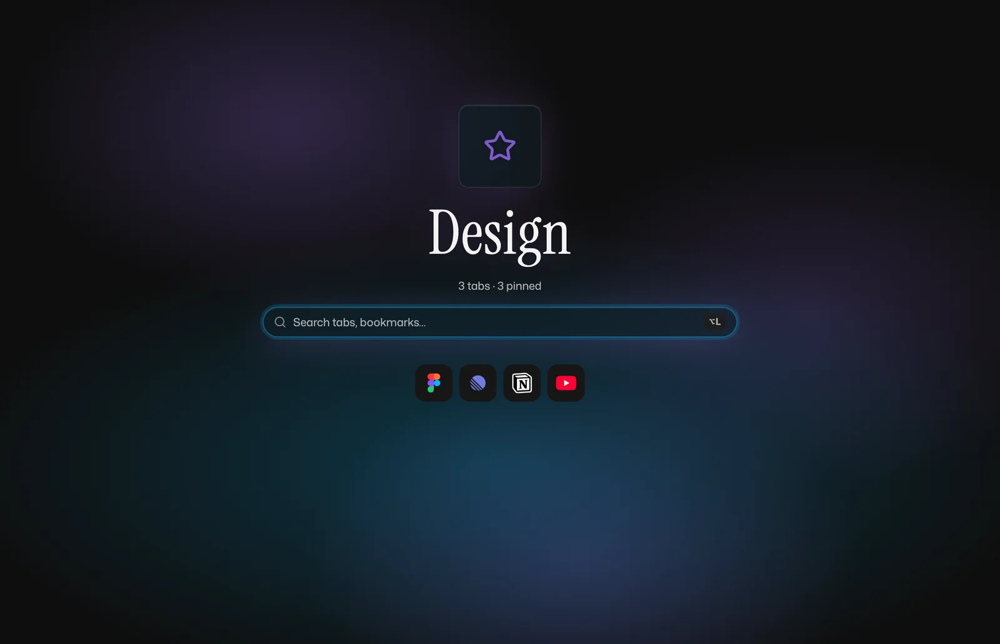

# Lunma

[](https://github.com/lunma-app/lunma/actions/workflows/ci.yml)

A Chrome extension for vertical tab spaces. Spec-driven, TypeScript-strict, Svelte 5.

<p align="center">
  
  
</p>

- **Author:** The Lunma Authors
- **Status:** Active development — pre-release
- **Inspired by:** Arcify v4 by Nisarg Kolhe — Lunma is a clean-room reimplementation that builds on Arcify's ideas with its own architecture and codebase.

## Why I built it

I wanted Arc's Spaces without leaving Chrome: one colour-coded workspace per project,
tabs that stay pinned across restarts, and everything else archived when I stop
touching it. Backing that state with the Chrome bookmark tree means a binding-and-drift
layer to keep two copies in step (`docs/adr/0001`), so Lunma owns its records locally
and materialises each Space as a real Chrome tab group: the tab strip and the sidebar
always agree, and the extension stays small.

## What Lunma delivers

A Chrome Manifest V3 extension that gives every project its own colour-coded vertical workspace — the Spaces pattern Arc popularised, brought to the browser you already use:

- **Spaces** — Chrome tab groups augmented with metadata; one active Space per window
- **Pinned tabs** — durable saved tabs owned by Lunma in `chrome.storage.local`; backup and restore as a file
- **Temporary tabs** — ephemeral; archived automatically when idle
- **Favicon row** — compact bar of saved shortcuts with live-tab binding
- **Launcher** — keyboard search across tabs, bookmarks, history (overlay + new-tab page)
- **Options** — schema-driven settings UI
- **Onboarding** — install + update flows from a single source of content

## What Lunma emphasizes

- **TypeScript strict** end to end — types are part of the design, not an afterthought.
- **A single, serialized store.** A class with synchronous, void-returning mutators and a coordinator drain loop that processes all Chrome events and user actions in order. No action union, no reducer, no interleaved mutations.
- **Versioned storage.** Every persisted read flows through a Zod schema with an append-only migrations table.
- **Honest layer boundaries.** Chrome APIs, business logic, persistence, and DOM each live in their own modules with one-way dependencies.
- **Svelte 5 + scoped styles.** Tiny runtime, CSS isolated per component, byte budget honored for the `<all_urls>` overlay.
- **Tests carry weight.** Vitest for store methods, migrations, and search; Playwright for sidebar smoke.
- **Spec-driven development.** Each capability has an OpenSpec spec authored before code.
- **MV3-native build.** `@crxjs/vite-plugin` does the heavy lifting; no custom build glue.

## Repository layout

A **pnpm workspace** with two apps and one shared package:

```
apps/extension/    # the Chrome MV3 extension (@lunma/extension)
apps/site/         # the marketing landing page for lunma.app (@lunma/site) — SvelteKit + adapter-static
packages/tokens/   # @lunma/tokens — CSS-only shared design language (tokens + brand fonts + aurora/glass/glow recipes)
```

Both apps consume `@lunma/tokens` via `workspace:*`, so the site renders the
extension's exact design language with zero copy-drift. The two apps never import
each other (gated both ways by Biome). The extension's internal one-way layer DAG
lives under `apps/extension/src/` (see `docs/architecture.md`).

## Reading order

1. `docs/tech-stack.md` — the chosen stack and the rationale behind each choice
2. `docs/architecture.md` — project layout, the store and event-coordinator patterns, the import DAG, and the MV3 boot sequence

Capability behavior lives in the living specs under `openspec/specs/`; durable design decisions under `docs/adr/`.

## Develop

```sh
pnpm install                              # link the workspace
pnpm --filter @lunma/extension dev        # extension: Vite + crxjs dev build (load apps/extension/dist unpacked)
pnpm --filter @lunma/site dev             # site: SvelteKit dev server
pnpm test                                 # extension Vitest unit tests (delegates to @lunma/extension)
pnpm verify                               # pnpm -r verify — gates every package (extension + site)
pnpm --filter @lunma/extension build      # extension: production build → apps/extension/dist
pnpm --filter @lunma/site build           # site: static prerender → apps/site/build
pnpm test:e2e                             # extension Playwright smoke (delegates to @lunma/extension)
```

Releases are cut by release-please from Conventional Commits on `main`; the
extension's `package.json` version is canonical and tagged `vX.Y.Z`. See
`docs/releasing.md`.

Non-trivial work starts with an OpenSpec change under `openspec/changes/`
(see the `openspec-*` skills); each capability has a living spec under
`openspec/specs/`.

## License

Lunma is licensed under the **Apache License 2.0** — see [`LICENSE`](LICENSE). The
Lunma name and logo are **not** covered by that license; see [`TRADEMARK.md`](TRADEMARK.md)
(fork the code freely, but don't ship it as "Lunma"). Contributions are accepted
under Apache-2.0, certified with a Developer Certificate of Origin sign-off
(`git commit -s`). See [`DCO`](DCO) and [`CONTRIBUTING.md`](CONTRIBUTING.md).

Lunma is an independent, clean-room reimplementation by a different author, with no code
shared from Arcify v4 (GPL-3.0, author: Nisarg Kolhe), which it credits as inspiration.
